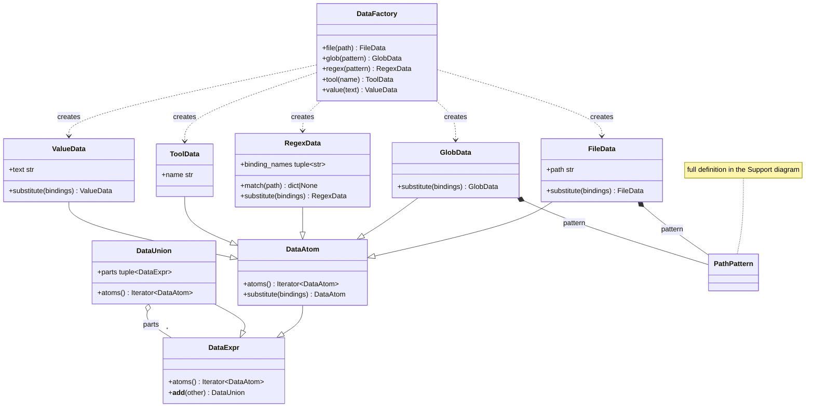
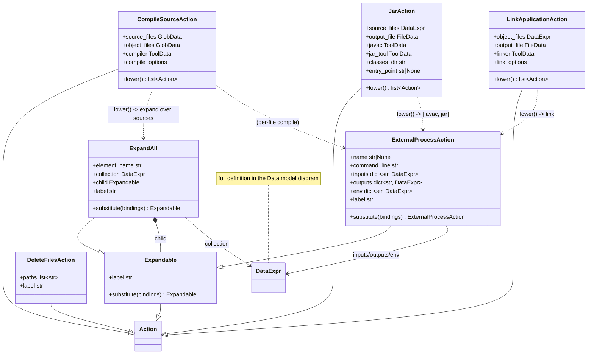
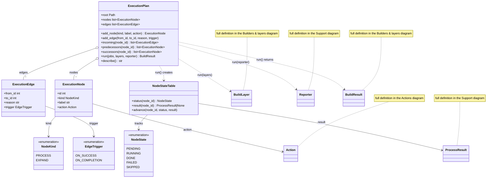
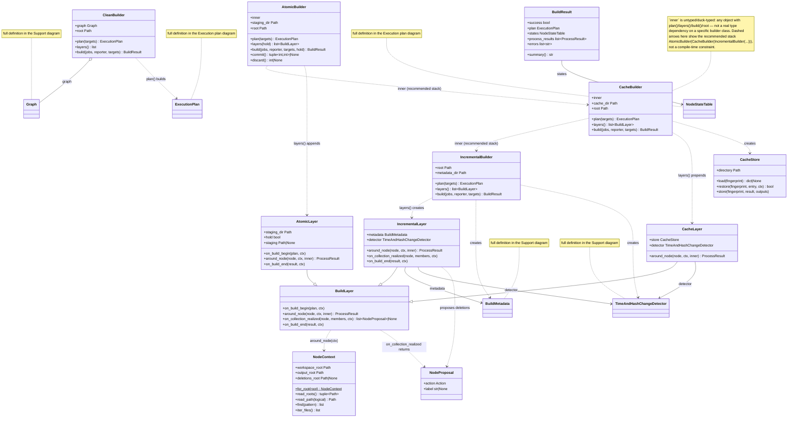
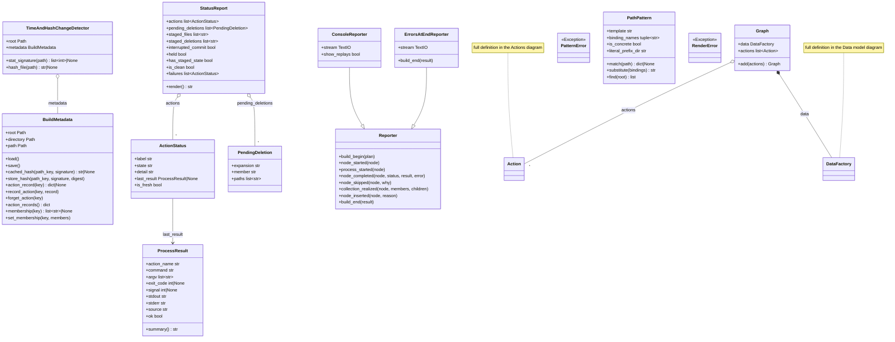

# Class diagrams

Every class in `src/brix/` (48 total), grouped into five readable diagrams
rather than one unreadable graph. Each diagram below is the Mermaid
`classDiagram` source followed by its rendered SVG; open the SVG directly in
a browser for the sharpest view (GitHub also renders the Mermaid blocks
inline).

Notes on reading these:
- Dashed arrows (`..>`) are dependencies ("uses" / "creates" / "returns"),
  not ownership.
- Filled-diamond arrows (`*--`) are composition (owns, same lifetime);
  open-diamond arrows (`o--`) are aggregation (holds a reference/collection).
- A class shown with no members and a yellow note ("full definition in the
  ___ diagram") is a cross-reference into another diagram — it exists here
  only to show a relationship, not to duplicate its definition.
- Union-ish annotations like `int|None` and generics like `list~str~` are
  Python type hints transliterated into Mermaid's member syntax, not UML
  formalism.

## 1. Data model (`data.py`)

The logical data expressions: `data.file(...)`, `data.glob(...)`, etc. Clean
build truth — no caching or staging concerns here.





## 2. Actions (`actions.py`, `java.py`, `cpp.py`)

What the graph declares: generic process actions plus the typed C++/Java
helpers that lower into them.





## 3. Execution plan (`plan.py`)

The graph-shaped structure of one build: append-only nodes/edges plus the
scheduler-owned state table.





## 4. Builders & layers (`builders.py`, `layers.py`, `incremental.py`, `cache.py`, `atomic.py`)

The capability stack: `CleanBuilder`/`IncrementalBuilder` are root builders;
`CacheBuilder` and `AtomicBuilder` wrap another builder and each contribute
one `BuildLayer` to the middleware stack (recommended nesting:
`AtomicBuilder(CacheBuilder(IncrementalBuilder(...)))`).





## 5. Support (`metadata.py`, `status.py`, `report.py`, `process.py`, `graph.py`, `patterns.py`, `render.py`)

Persistence, status inspection, reporting, process results, the top-level
`Graph`, and path-pattern matching.





## Regenerating / verifying

```
cd docs && npx @mermaid-js/mermaid-cli -i class-diagrams/<name>.mmd -o class-diagrams/<name>.svg
```

**Verification gotcha found while making these**: the SVGs Mermaid produces
embed class-member text via `<foreignObject>` HTML, not native SVG `<text>`
elements. `rsvg-convert` silently drops all of that text (it doesn't support
`foreignObject`), so a `rsvg-convert`-rendered PNG looks like empty boxes —
that's a viewer limitation, not a broken diagram. To verify a diagram
actually contains its labels, render straight to PNG with `mmdc` itself
(`mmdc -i file.mmd -o file.png`), which uses its bundled Chromium and
renders the HTML correctly. Headless Vivaldi was also tried for
verification and hung/timed out on this machine (heavy vendor profile
init) — mmdc's own puppeteer-managed Chromium worked reliably instead.
